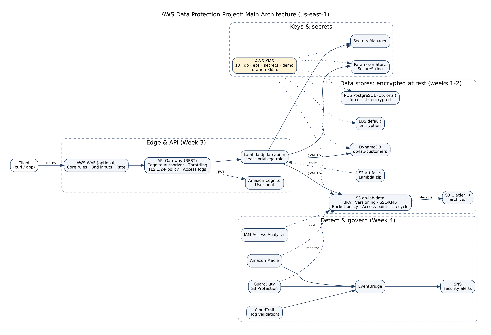

# AWS Data Protection, Encryption & Privacy Compliance

**DEPI Graduation Project — Cloud Security Track**

An end-to-end, audit-ready data protection lab on AWS: data classification and S3 hardening,
encryption at rest with AWS KMS, encryption in transit with TLS / secrets management / API protection,
and sensitive-data discovery, threat detection, DLP and GDPR / HIPAA / PCI DSS control mapping.

## Team

| Member | Role | Owns |
|---|---|---|
| Ahmed Ali | Team Lead | Kickoff (account, repo, CloudTrail) · Week 4: Macie, GuardDuty, DLP, compliance, final report |
| Ahmed Shaaban | Data & S3 | Week 1: lifecycle, classification, S3 secure baseline, access review |
| Ammar | Encryption at rest | Week 2: KMS key hierarchy, key policies, rotation, encrypted data stores, CloudHSM comparison |
| Mohamed Essam Elbastawisy | Transit & API | Week 3: demo app, TLS/ACM, Secrets Manager, Parameter Store, API protection, data-in-transit |

## Project conventions

| Item | Value |
|---|---|
| Region | `us-east-1` (single region for everything) |
| Naming | `dp-lab-<service>-<purpose>` (S3 buckets get a random suffix, e.g. `dp-lab-data-7k3q`) |
| Mandatory tags | `Owner=<member>`, `Environment=Lab`, `Project=DataProtection` (+ `DataClassification=<level>` on data resources) |
| CLI | AWS CloudShell only — no access keys on laptops |
| Test data | 100% fake, generated by [`tools/generate_fake_data.py`](tools/generate_fake_data.py) |

## Repository map

| Folder | What's inside |
|---|---|
| [`docs/`](docs/) | [Setup guide](docs/SETUP.md), [evidence standard](docs/EVIDENCE-STANDARD.md), [demo script](docs/DEMO-SCRIPT.md), [cost guide](docs/COST-GUIDE.md), [teardown](docs/TEARDOWN.md), [troubleshooting](docs/TROUBLESHOOTING.md) |
| [`architecture/`](architecture/) | Main architecture, data lifecycle and data-in-transit diagrams |
| [`week-0-setup/`](week-0-setup/) | Account security, Identity Center, budget, CloudTrail |
| [`week-1-s3/`](week-1-s3/) | Classification, S3 baseline, bucket / access-point / lifecycle policies, access review, handling standard |
| [`week-2-kms/`](week-2-kms/) | Key hierarchy, key policy, encrypted data stores, KMS lab, rotation/audit plan, CloudHSM vs KMS |
| [`week-3-tls-secrets/`](week-3-tls-secrets/) | Demo app (API Gateway + Lambda), TLS/ACM, certificates, secrets rotation, API security, transit architecture, VPN/IPsec |
| [`week-4-compliance/`](week-4-compliance/) | Macie & GuardDuty reports, DLP plan, compliance matrix, risk register, audit checklist |
| [`final-report/`](final-report/) | Final audit-ready report outline |
| [`scripts/`](scripts/) | Copy-paste CloudShell runbooks for every week |
| [`tools/`](tools/) | Fake data generator |

Every week folder has a `screenshots/` directory with a `CHECKLIST.md` listing the exact evidence to capture.

## The 21 deliverables

| # | Deliverable | Path |
|---|---|---|
| 1 | Data Classification Scheme | [week-1-s3/data-classification.md](week-1-s3/data-classification.md) |
| 2 | S3 Secure Baseline | [week-1-s3/s3-secure-baseline.md](week-1-s3/s3-secure-baseline.md) |
| 3 | Bucket Policy Examples | [week-1-s3/bucket-policy-examples.md](week-1-s3/bucket-policy-examples.md) |
| 4 | Access Review | [week-1-s3/access-review.md](week-1-s3/access-review.md) |
| 5 | Lifecycle Policy | [week-1-s3/lifecycle-policy.json](week-1-s3/lifecycle-policy.json) · [data-lifecycle.md](week-1-s3/data-lifecycle.md) |
| 6 | Data Handling Standard | [week-1-s3/data-handling-standard.md](week-1-s3/data-handling-standard.md) |
| 7 | KMS Key Hierarchy | [week-2-kms/key-hierarchy.md](week-2-kms/key-hierarchy.md) |
| 8 | Key Policy Design | [week-2-kms/key-policy-design.md](week-2-kms/key-policy-design.md) · [key-policy.json](week-2-kms/key-policy.json) |
| 9 | Encrypted Data Stores | [week-2-kms/encrypted-data-stores.md](week-2-kms/encrypted-data-stores.md) |
| 10 | KMS Lab Evidence | [week-2-kms/kms-lab.md](week-2-kms/kms-lab.md) |
| 11 | Key Rotation / Audit Plan | [week-2-kms/rotation-audit-plan.md](week-2-kms/rotation-audit-plan.md) · [cloudhsm-vs-kms.md](week-2-kms/cloudhsm-vs-kms.md) |
| 12 | TLS / ACM Setup | [week-3-tls-secrets/tls-acm-setup.md](week-3-tls-secrets/tls-acm-setup.md) |
| 13 | Certificate Inventory | [week-3-tls-secrets/certificate-inventory.md](week-3-tls-secrets/certificate-inventory.md) |
| 14 | Secrets Rotation Design | [week-3-tls-secrets/secrets-rotation-design.md](week-3-tls-secrets/secrets-rotation-design.md) |
| 15 | API Security Controls | [week-3-tls-secrets/api-security.md](week-3-tls-secrets/api-security.md) |
| 16 | Data-in-Transit Architecture | [week-3-tls-secrets/data-in-transit-architecture.md](week-3-tls-secrets/data-in-transit-architecture.md) · [vpn-ipsec-concepts.md](week-3-tls-secrets/vpn-ipsec-concepts.md) |
| 17 | Macie Findings Report | [week-4-compliance/macie-findings-report.md](week-4-compliance/macie-findings-report.md) · [guardduty-findings.md](week-4-compliance/guardduty-findings.md) |
| 18 | DLP Plan | [week-4-compliance/dlp-plan.md](week-4-compliance/dlp-plan.md) |
| 19 | Compliance Control Matrix | [week-4-compliance/compliance-matrix.xlsx](week-4-compliance/compliance-matrix.xlsx) |
| 20 | Data Protection Risk Register | [week-4-compliance/risk-register.xlsx](week-4-compliance/risk-register.xlsx) |
| 21 | Final Audit-Ready Data Security Report | [final-report/](final-report/) |

## Quick start

1. Read [docs/SETUP.md](docs/SETUP.md) — prerequisites, account hardening and how to run each week.
2. Open AWS CloudShell, clone this repo, and follow `scripts/week-N-*.sh` step by step (they are runbooks: run one block at a time, read the output, capture the screenshot).
3. Fill the `<!-- RESULT -->` placeholders in each document with your real outputs.
4. Tear everything down with [docs/TEARDOWN.md](docs/TEARDOWN.md).

## Important

- **No real personal data** is used anywhere. All "sensitive" data is generated by Faker.
- **Never commit** account IDs, ARNs with account IDs, passwords, tokens or secret values. See [docs/EVIDENCE-STANDARD.md](docs/EVIDENCE-STANDARD.md).
- Compliance wording: controls are **mapped to** GDPR / HIPAA / PCI DSS. A lab with fake data is not "compliant" or certified.
- Prices and console labels change over time — verify on AWS pricing/documentation pages.
