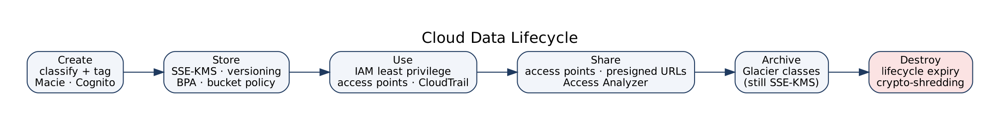

# Cloud data lifecycle

Owner: Ahmed Shaaban

Data goes through six stages. Each needs something different, so we list what protects it at each one in this lab.

| Stage | What happens | What protects it here |
|---|---|---|
| Create | Data arrives (upload, import, API) | Classified on the way in: prefix + `DataClassification` tag. API callers must authenticate with Cognito |
| Store | Sits in S3, DynamoDB, RDS, EBS | SSE-KMS with our keys, versioning, Block Public Access, bucket policy |
| Use | Read by apps and people | IAM least privilege, access point for analytics, CloudTrail, S3 access logs |
| Share | Handed to another team or partner | Prefix-scoped access point, short presigned URLs, Access Analyzer watching for external access |
| Archive | Rarely needed, kept for retention | Lifecycle transition to Glacier classes, still encrypted with the same key |
| Destroy | End of retention | Lifecycle expiration, old versions expired, key deletion at the very end |

Two things worth calling out:

**Classification happens at Create and decides everything after it.** Which key, which prefix, who can read it, how long we keep it. That's why it is the first deliverable.

**Destroy has a shortcut called crypto-shredding.** Once nothing else needs a key, scheduling its deletion makes every copy encrypted under it unreadable, including copies you forgot about in backups or old versions. You don't have to find every copy to make it unrecoverable.

Versioning protects us during Store and Use (accidental delete, overwrite, ransomware), but it would also keep deleted data forever. The `cleanup-old-versions-and-uploads` lifecycle rule closes that gap by expiring noncurrent versions after 30 days. See [lifecycle-policy.md](lifecycle-policy.md).
