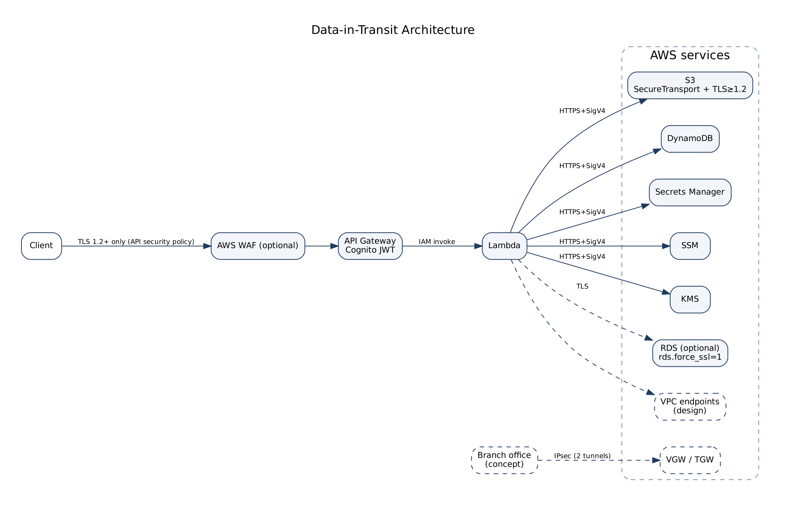

# Data-in-transit architecture

Deliverable 16. Owner: Mohamed Essam Elbastawisy



| Hop | How it's protected | Test |
|---|---|---|
| Client to API | TLS 1.2+ (API security policy), HTTP not served | T20, T21 |
| Edge | WAF managed rules + rate limit | T24 |
| API Gateway | Cognito token check, throttling, access logs | T22, T23, T25 |
| API Gateway to Lambda | inside AWS, invocation allowed by a resource policy for this API and route only | - |
| Lambda to DynamoDB, S3, Secrets Manager, SSM, KMS | HTTPS with SigV4-signed requests (SDK default) | - |
| Anyone to the data bucket | bucket policy denies non-TLS and TLS < 1.2 | T06 |
| Client to RDS | `rds.force_ssl = 1` | T17 |
| Private paths (design) | gateway endpoints for S3 and DynamoDB (free), interface endpoints for KMS, Secrets Manager, SSM (hourly), each with an endpoint policy | - |
| Office to AWS (design) | Site-to-Site VPN or Direct Connect with MACsec, see [vpn-ipsec.md](vpn-ipsec.md) | - |

## Why the Lambda isn't in a VPC

Putting it in a VPC wouldn't make its traffic more encrypted (it's already TLS to every AWS endpoint) and it would need interface endpoints for KMS, Secrets Manager and SSM, which bill by the hour. For production with RDS in a private subnet, the design is: Lambda in private subnets, gateway endpoints for S3 and DynamoDB, interface endpoints for the rest, and the "only from our VPC endpoint" bucket policy from [bucket-policy.md](../week-1-s3/bucket-policy.md).

## RDS

With `ENABLE_RDS=true`, the parameter group sets `rds.force_ssl = 1`, so PostgreSQL refuses unencrypted connections. (PostgreSQL 15 and later already default to this on RDS; we set it explicitly so it doesn't depend on a default.) For MySQL the equivalent is `require_secure_transport = ON`.

```bash
aws rds describe-db-parameters --db-parameter-group-name <group> \
  --query "Parameters[?ParameterName=='rds.force_ssl'].[ParameterName,ParameterValue]"
```
